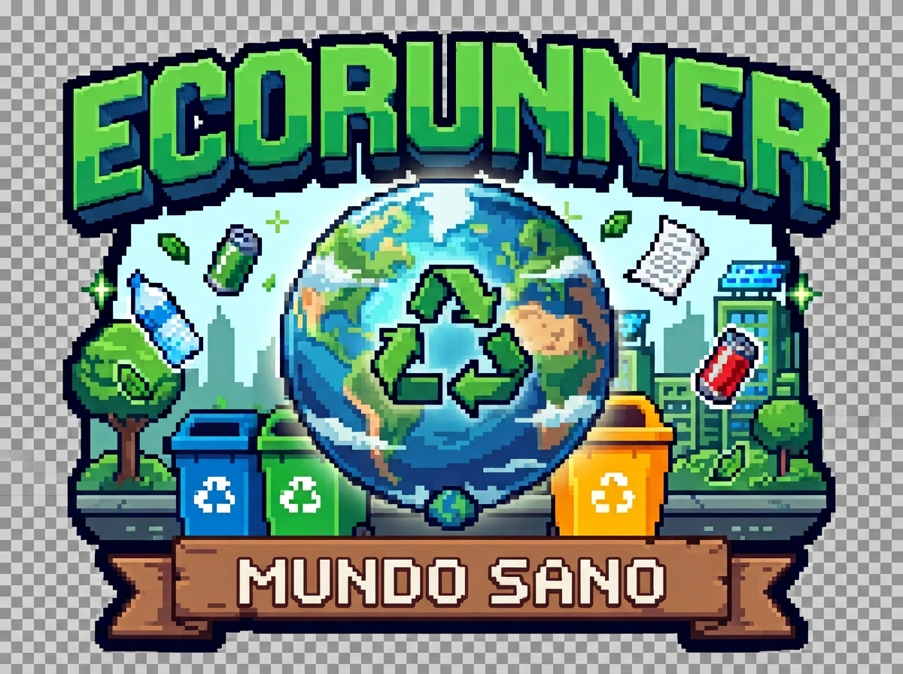
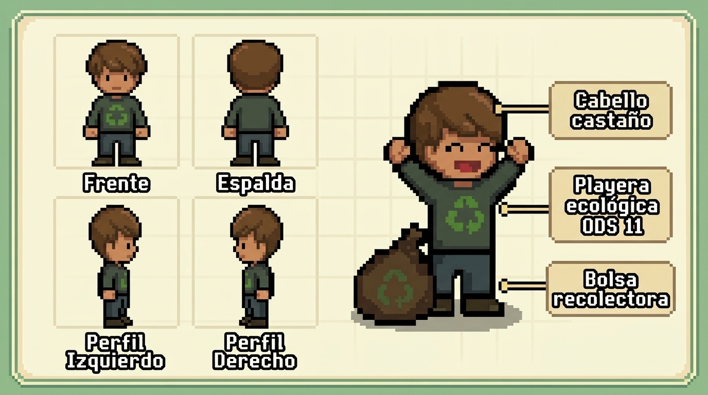
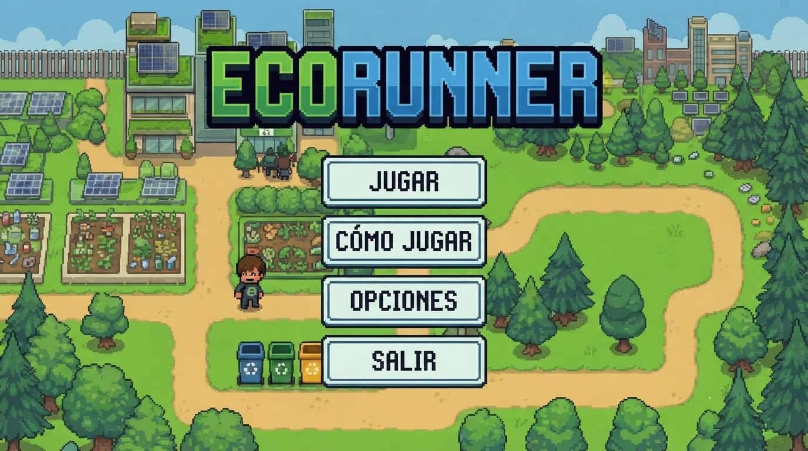
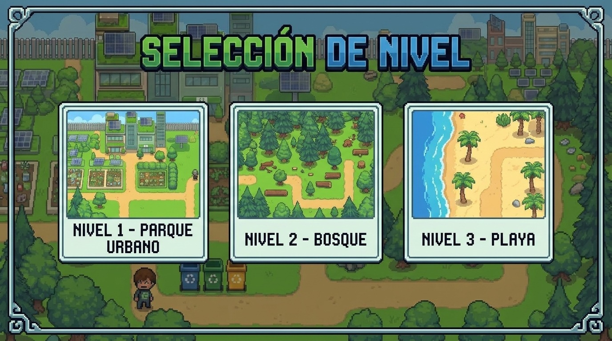
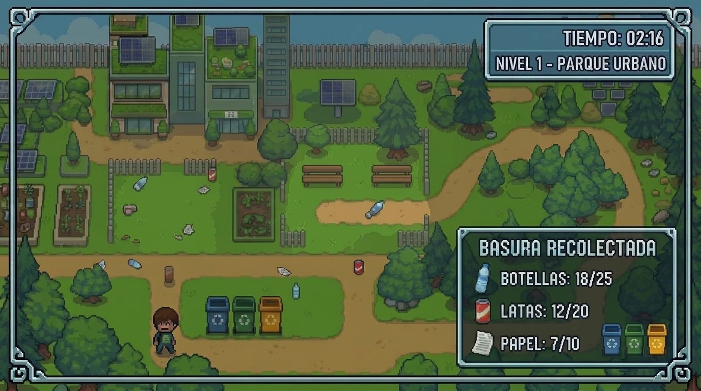
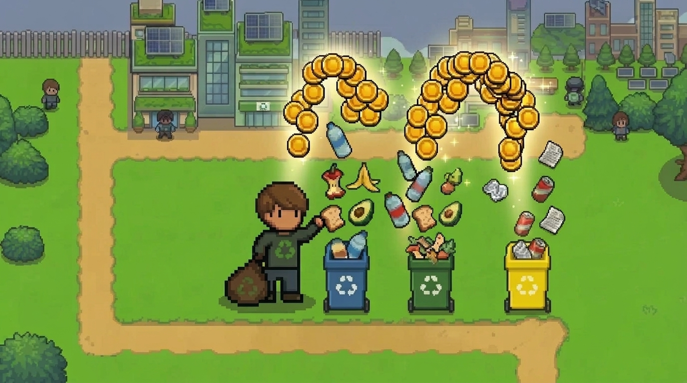
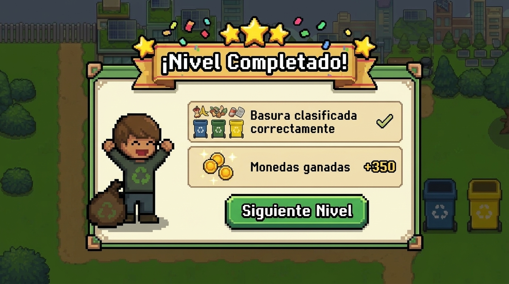

# PROYECTO_INTEGRADOR_ECO_RUNNER
Videojuego educativo 2D en Python (Pygame) inspirado en el ODS 11: Recolecta, Corre, Clasifica y Gana.
<div align="center">

  

  # 🌱 ECO-RUNNER: MUNDO SANO — Videojuego Educativo Ambiental
  *Recolecta · Corre · Clasifica · Gana — Inspirado en el ODS 11 (Ciudades y Comunidades Sostenibles)*

  <br/>

  
  
  
  

  <br/>

  *PROYECTO INTEGRADOR EN DESARROLLO · FASES DE ANÁLISIS, DISEÑO UML Y PROTOTIPADO DE PANTALLAS*

  <br/>

  [DESCRIPCIÓN](#descripción-del-proyecto) &nbsp;·&nbsp;
  [ESTRUCTURA](#estructura-del-repositorio) &nbsp;·&nbsp;
  [MECÁNICA](#mecánica-y-tecnologías) &nbsp;·&nbsp;
  [PERSONAJE](#diseño-del-personaje) &nbsp;·&nbsp;
  [PANTALLAS](#diseño-de-pantallas) &nbsp;·&nbsp;
  [EQUIPO](#equipo-de-desarrollo)

</div>

---


## Descripción del proyecto

**Eco-Runner: Mundo Sano** es un videojuego 2D en perspectiva cenital (*top-down*) con estética *pixel art* desarrollado en **Python** mediante la librería **Pygame**, diseñado para fomentar la cultura del reciclaje y el cuidado de los espacios públicos en alineación con el **Objetivo de Desarrollo Sostenible 11 (Ciudades y Comunidades Sostenibles)**.

El jugador recorre distintos escenarios contaminados (parque urbano, bosque y playa) para recolectar residuos contrarreloj y clasificarlos correctamente en los contenedores de reciclaje a cambio de monedas.

---


## Estructura del repositorio

El proyecto documenta las primeras fases del ciclo de vida del desarrollo de software:

```text
PROYECTO_INTEGRADOR_ECO_RUNNER/
├── README.md                        # Documentación principal y presentación del proyecto
├── 1-requerimientos/                # Fase 1: Especificación de Requerimientos (IEEE 830)
│   └── SRS.md                       # Requerimientos funcionales, no funcionales y criterios de aceptación
├── 2-uml/                           # Fase 2: Modelado y Arquitectura del Sistema
│   └── diagramas.md                 # Diagramas de Casos de Uso, Clases y Secuencia
└── 3-pantallas/                     # Fase 3: Diseño de Interfaces (UI/UX) y Arte Conceptual
    ├── logo-ecorunner.png.jpg
    ├── 01-inicio.png.jpeg
    ├── 02-seleccion-nivel.png.jpeg
    ├── 03-juego-principal.png.jpeg
    ├── 04-clasificacion.png.jpg
    ├── 05-resultados.png.jpg
    └── 06-personaje.png.jpg
```
---


## Mecánica y tecnologías

| Componente | Descripción |
| :--- | :--- |
| **Lenguaje y motor** | **Python 3 + Pygame** (gestión de *sprites*, detección de colisiones *hitbox*, bucle de juego a 60 FPS y renderizado de mapas 2D) |
| **Ciclo de juego** | **1. Recolecta** residuos en el mapa → **2. Corre** contra el temporizador → **3. Clasifica** en contenedores (Azul, Verde, Amarillo) → **4. Gana** monedas |
| **Escenarios** | Parque Urbano, Bosque y Playa (progresión por niveles) |
| **Modelado y UI** | Diagramas UML en **Mermaid** y galería de recursos visuales respaldada en **Google Drive** |

---


## Diseño del personaje

| Vista conceptual (*Sprite Sheet*) | Características y rol |
| :---: | :--- |
|  | **Protagonista (Eco-Runner):**<br>• **Estilo:** *Pixel art* 2D estructurado en *sprites* para **Pygame** (4 direcciones de movimiento: arriba, abajo, izquierda y derecha).<br>• **Indumentaria:** Playera verde ecológica con emblema de reciclaje y bolsa recolectora para almacenar residuos durante la ronda. |

---


## Diseño de pantallas

* **Enlace a todas las imágenes y diseño en Google Drive:** [Ver carpeta completa aquí](https://drive.google.com/drive/folders/1cHeQo8Ro_NuCf2HpUFBt1dOh6esDGxwZ?usp=drive_link)

| Pantalla | Vista previa | Descripción funcional |
| :--- | :---: | :--- |
| **1. Inicio** |  | Menú principal con título del juego, botón de iniciar partida y opciones. |
| **2. Selección de Nivel** |  | Elección de escenario ecológico (Parque Urbano, Bosque o Playa). |
| **3. Juego Principal** |  | Vista cenital con HUD en español (tiempo, nivel y contadores de residuos). |
| **4. Clasificación** |  | Interacción con contenedores de reciclaje por color para depositar la basura recolectada. |
| **5. Resultados** |  | Resumen de residuos clasificados, monedas ganadas y avance al siguiente nivel. |

---


## Equipo de desarrollo

| Integrante | Rol en el proyecto | Usuario GitHub | Perfil y contacto |
| :--- | :--- | :--- | :--- |
| **Gamaliel López Pazos** | Análisis de requerimientos (SRS), lógica de juego en Python/Pygame y HUD | `@Gamalopez-18` | [github.com/Gamalopez-18](https://github.com/Gamalopez-18) |
| **Irving Emiliano Rivera Matus** | Modelado UML (Casos de uso, Clases, Secuencia) y diseño de interfaces/personaje | `@Kuruboy` | [github.com/Kuruboy](https://github.com/Kuruboy) |
